# Xan's Music Ratings Desktop

一个专为个人长期收藏打造的 Windows 音乐评分与乐评管理软件。

它不是播放音乐的听歌软件，也不是在线搜索匹配评分的数据社区，而是一份完完全全属于你自己的**私人音乐档案库**。

就像一本专为你定制的数字音乐手账：本软件不提供在线音频流媒体，也不会自动联网抓取数据；所有的专辑、单曲、分数、长篇短评以及高清封面，都由你自己亲手录入、整理并保存在本地电脑中（也支持通过纯文本格式批量导入）。安安心心，完全由你掌控。

无论你是习惯在听完一张新唱片后随手记下几笔听感，还是在每年年末认真评出自己的年度最佳（AOTY / SOTY）并写下长篇小作文，亦或是想把几十年来听过的上千张唱片按年代整理成册，它都能为你提供一个专注、纯粹且极具质感的私人记录空间。

这里没有流媒体突如其来的下架变动，也没有社交网络的算法噪音与数据绑架。所有内容完全离线保存在你的本地电脑中，无需联网，打开即用。从细致到每首歌的逐曲打分与多碟管理，到纵跨数十年的全盘统计与走势图表，它会为你安安静静沉淀出一张独一无二的私人音乐编年史。

<p align="center">
  <a href="docs/screenshots/overview.png">
    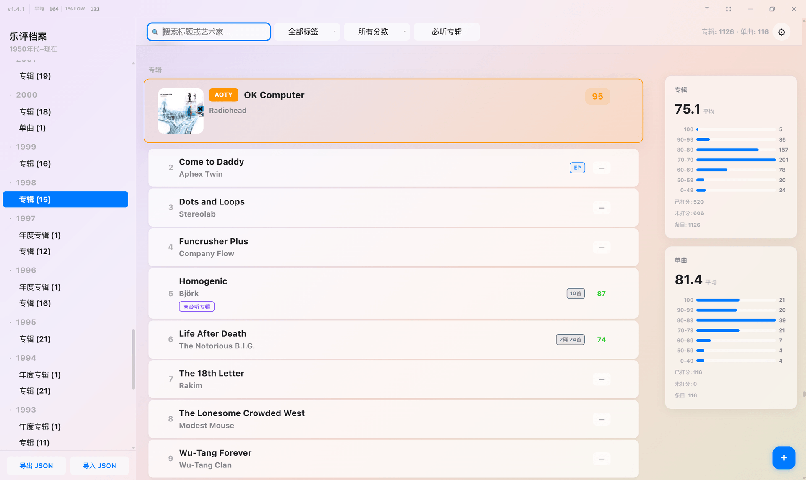
  </a>
</p>
<p align="center"><sub>年代导航、AOTY、评分列表、分数分布与运行状态监视器</sub></p>

> 本软件为 Windows 桌面专属程序，所有数据均保存在本地电脑中，断网也可完整使用。

## 下载使用

前往 [GitHub Releases](https://github.com/DEVILISALIE/Xan-s-Music-Ratings-Data/releases) 下载最新 Windows 安装包（`.msi`）或免安装便携版（`.exe`）。

当前版本：`v1.6.4`

## 把几十年的音乐放在同一张时间轴上

左侧用年代与年份把所有专辑和单曲整理得井井有条，中间展示每一年的音乐卡片，右侧则实时汇总你的整体评分分布。即使收藏了上千张唱片，点击左侧侧边栏也能瞬间跳转到对应的年份，滚动时导航高亮会自动跟手同步。

不同年代支持智能排序：新专辑按发行日期排序，老唱片按年份倒序排好，年度最佳（AOTY/SOTY）永远稳居最前面。每张卡片上清晰标有评分、发行时间、自定义标签、曲目数量以及高分必听（★Must Hear）徽标，翻看时一目了然。

## 年度专辑与年度单曲是绝对的主角

年度选择不仅是一个普通标签。年度专辑（AOTY）和年度单曲（SOTY）享有尊贵的大卡片待遇，稳稳置顶在对应年份的最上方，成为你音乐记忆里的高光时刻。

<p align="center">
  <a href="docs/screenshots/aoty-review.png">
    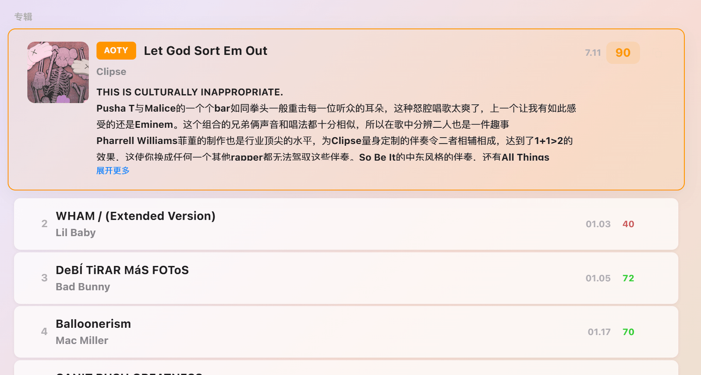
  </a>
</p>
<p align="center"><strong>AOTY 与长篇乐评</strong><br><sub>封面、日期、评分和万字长评汇集于一张大卡片中，篇幅较长时可自由展开/折叠</sub></p>

你可以把几百上千字的长篇深度乐评直接写在卡片里。卡片平时保持整洁紧凑的折叠状态，点击即可展开全文阅读，既方便快速翻找，也能原汁原味记录下你当年的真实听感。

<p align="center">
  <a href="docs/screenshots/soty-card.png">
    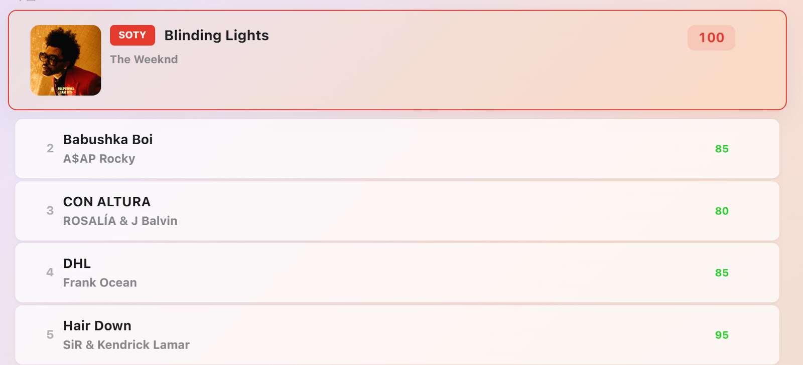
  </a>
</p>
<p align="center"><strong>SOTY 年度单曲</strong><br><sub>专辑与单曲共用同一套年度评选体系，同时拥有各自独立的列表和统计</sub></p>

## 全局搜索与一键跳转

<p align="center">
  <a href="docs/screenshots/search-navigation.png">
    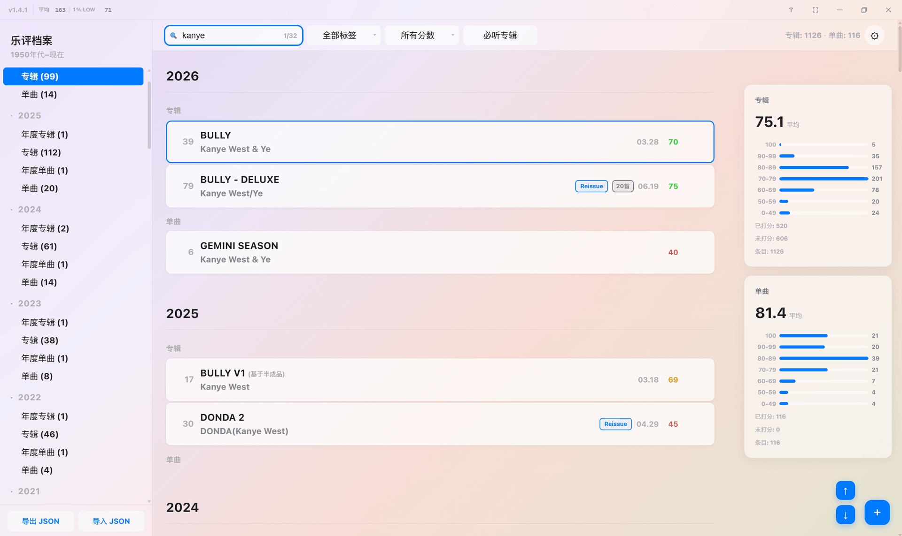
  </a>
</p>
<p align="center"><sub>搜索框显示匹配数量，右下角悬浮按钮支持在结果间上下快速循环跳转</sub></p>

搜歌名、搜歌手、搜打分备注，甚至搜乐评里的某一句原话，都能瞬间跨越几十年精准找出所有结果。不用自己在漫长的时间轴里眼花缭乱地上下翻找，只需点击右下角的“上一个 / 下一个”按钮（或按键盘方向键），页面就会丝滑滚动并圈出目标卡片。

还可以把搜索和标签多选、分数区间（如 90分以上、未打分 NR）叠加使用，找歌挑歌更加随心所欲。

## 细致的逐曲评分与多碟管理

一张专辑往往不必只留下一个冰冷的总分。点击右侧的统计卡片，可以把总览展开为逐年的独立平均分趋势，清楚看到自己每一年听歌打分的口味变化。

<p align="center">
  <a href="docs/screenshots/yearly-stats.png">
    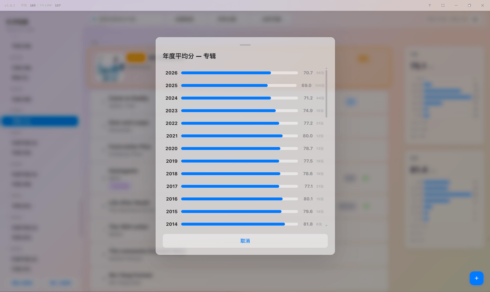
  </a>
</p>
<p align="center"><sub>每年独立平均分、相对分数柱和有效条目数集中在同一视图中对比</sub></p>

在专辑编辑窗口中，你可以给每一首歌单独填写歌名和打分（0–100 分）；如果有些歌暂时不想打分，也可以标记为 `NR`，它不会被计入平均分。软件还会根据你选择的是专辑还是单曲，智能联动表单——如果是单曲，不适用的专辑专属标签（如 EP、Mixtape、Live 等）会顺滑地自动收起；若是专辑则平滑舒展呈现，始终保持界面纯粹清爽。

<p align="center">
  <a href="docs/screenshots/track-ratings-nr.png">
    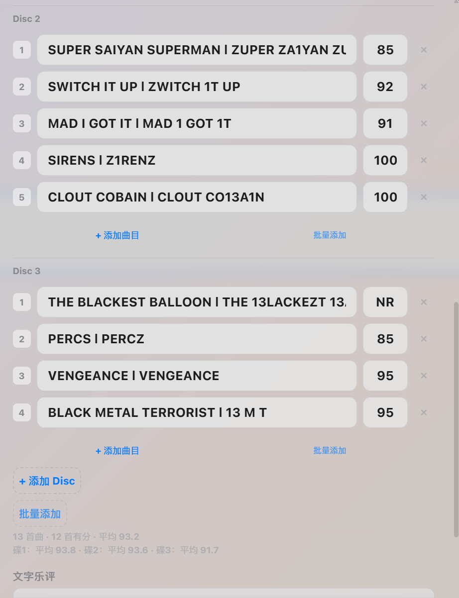
  </a>
</p>
<p align="center"><sub>歌名与逐曲评分、多碟分组、曲目增删、批量补齐及分碟平均分</sub></p>

遇到双碟甚至多碟的豪华版专辑（Disc 1 / Disc 2），可以轻松分碟整理。每一碟都支持一键批量补齐或删减歌曲数量，软件会实时算出整张唱片和每一碟的独立平均分；保存后，卡片上还会自动亮出“2碟 28首”的贴心标签。

## 本地封面与高清查看器

<p align="center">
  <a href="docs/screenshots/cover-editor.png">
    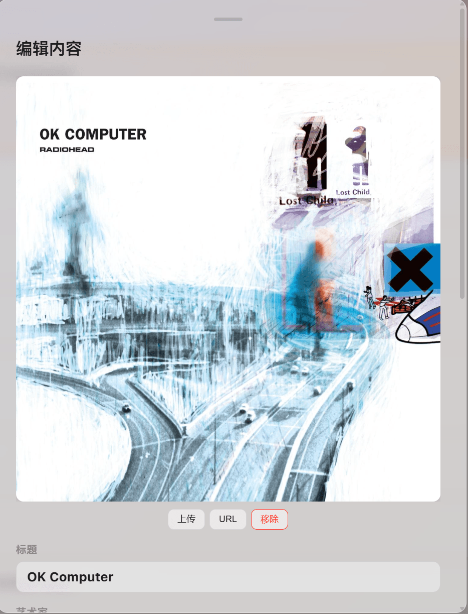
  </a>
</p>
<p align="center"><sub>支持本地上传、网络图片链接、快捷移除与高清大图预览</sub></p>

你可以给任意专辑添加封面，支持本地图片文件或网络图片 URL。日常浏览列表时，封面会以轻快流畅的方式显示，即便存有上千张大图也不会卡顿；想看清唱片封面的艺术细节时，双击小图或点击弹窗中的“查看大图”，就能进入全屏查看器——滚动鼠标滚轮可平滑放大到 8 倍，按住鼠标拖拽平移，细细品味封套设计。

## 批量整理与条目快速复用

<p align="center">
  <a href="docs/screenshots/batch-management.png">
    
  </a>
</p>
<p align="center"><sub>多选模式支持全选、Shift 范围连选、批量加/删标签和跨年代移动</sub></p>

想要批量整理某一时期的收藏？打开批量模式，支持点击勾选、全选以及按住 `Shift` 键连续多选，底部的操作栏可以一键批量删除、增删标签或把一批专辑搬移到其他年份。

平时想调整同一组卡片的顺序，直接用鼠标拖动就能换位；遇到系列作品或格式相似的条目，点击卡片右上角的“复制”，即可在新建时一键粘贴全部内容，不用逐字重新打一遍。

## 随心搭配的外观风格

深色模式与毛玻璃质感彼此独立，浅色模式还支持自由挑选心仪的背景色调；不仅如此，本软件还支持中英文分开选择电脑里的字体，并可以通过滑块自由微调字体粗细，调出最符合你心意的排版气质。

<table>
  <tr>
    <td width="58%" valign="top">
      <a href="docs/screenshots/dark-mode.png">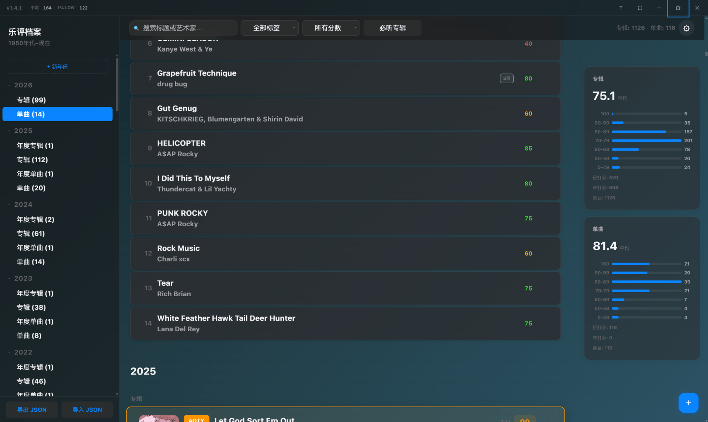</a>
    </td>
    <td width="20%" valign="top">
      <a href="docs/screenshots/appearance-settings.png">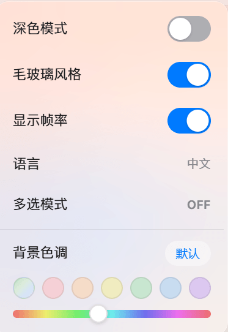</a>
    </td>
    <td width="22%" valign="top">
      <a href="docs/screenshots/font-settings.png">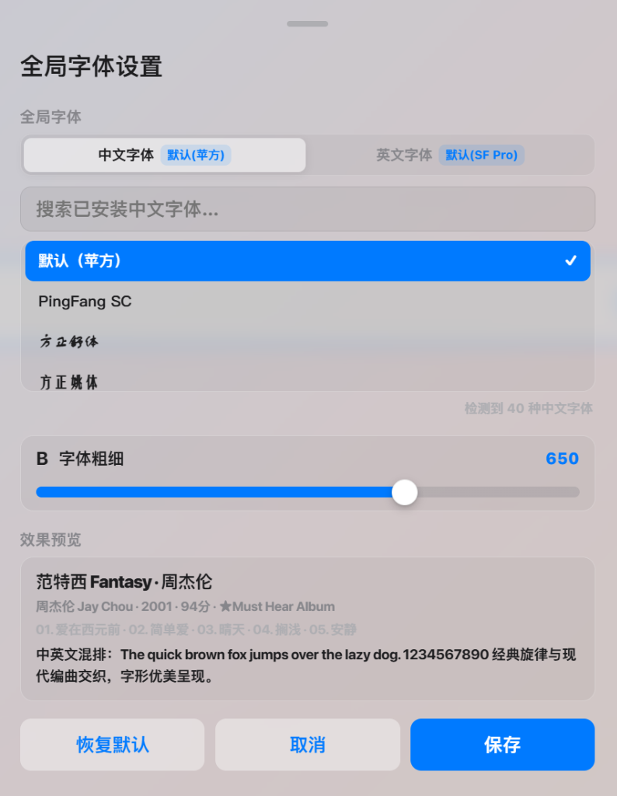</a>
    </td>
  </tr>
  <tr>
    <td align="center"><strong>深色毛玻璃</strong><br><sub>标题栏、工具栏与卡片通透协调</sub></td>
    <td align="center"><strong>个性化偏好</strong><br><sub>深浅主题、毛玻璃、色调微调</sub></td>
    <td align="center"><strong>全局字体与粗细</strong><br><sub>中英独立选择、粗细可调与实时预览</sub></td>
  </tr>
</table>

界面经过细致的性能调优，在普通屏幕与高刷显示屏上都能带来如丝般顺滑的滚动体验。

## 精致跟手的光标与微交互

软件不堆砌华而不实的动画，而是把功夫花在每一次鼠标滑动与点击的细节手感上。

<table>
  <tr>
    <td width="30%" align="center" valign="top">
      <a href="docs/screenshots/cursor-arrow.png"></a>
      <br><strong>精准箭头</strong>
      <br><sub>空白区域的轻盈白边黑底指针</sub>
    </td>
    <td width="30%" align="center" valign="top">
      <a href="docs/screenshots/cursor-pointer.png"></a>
      <br><strong>白手套食指</strong>
      <br><sub>按钮、卡片与可点击元素</sub>
    </td>
    <td width="40%" align="center" valign="top">
      <a href="docs/screenshots/cursor-text.png"></a>
      <br><strong>经典工字钢 (I-Beam)</strong>
      <br><sub>标题、歌手、乐评与输入框</sub>
    </td>
  </tr>
</table>

- **原生质感光标**：空白处是带柔和投影的精准箭头，移到卡片和按钮上自动变为圆润的手型指针，进入文字编辑框则是清晰的工字钢光标；移到滚动条上也不会变回粗糙的系统大指针。
- **全新悬浮滚动条**：摒弃了原本 Windows 浏览器自带的生硬粗边框，换上窄巧清透的悬浮滑块，平时自动隐匿，滚动或划过时淡入，不遮挡页面内容。

<p align="center">
  <a href="docs/screenshots/stats-exploration.png">
    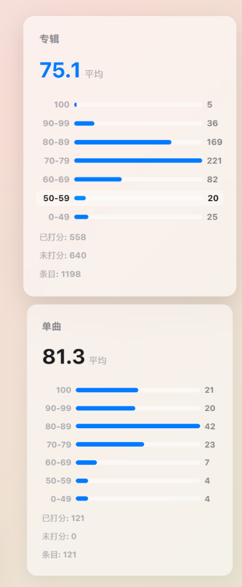
  </a>
</p>
<p align="center"><strong>灵动的数据统计</strong><br><sub>分数柱平滑生长展开，鼠标划过即时高亮，卡片悬浮富有微弹性反馈</sub></p>

右侧的分数统计卡片支持交互反馈：鼠标划过任意分数段时，对应的柱子会高亮增亮并显示数量；点击卡片有轻微的弹性回弹，在搜索时还能直接按键盘 `↑` / `↓` 方向键在结果卡片间快速跳转。

## 功能特性一览

| 维度 | 支持的功能 |
|---|---|
| 窗口操作 | 自定义无边框标题栏、窗口置顶、全屏切换、最小化/还原、任务栏图标点击切换 |
| 系统整合 | 电脑右下角托盘常驻与右键菜单、单实例运行（防止重复打开）、本地文件原生对话框 |
| 音乐记录 | 专辑总分、发行日期、标签分类（支持单曲/专辑智能联动收展）、单曲逐曲评分、多碟管理、封面图、长篇乐评 |
| 整理工具 | 年代自动排序、同组自由拖拽排序、批量多选（Shift 连选）、卡片整张复制粘贴 |
| 统计图表 | 专辑与单曲平均分、七档分数柱状分布图、历年平均分走势弹窗 |
| 视觉交互 | 专属原生矢量光标、悬浮滚动条、键盘快速搜索跳转、全屏封面 8 倍无级缩放 |
| 外观定制 | 中英文语言切换、亮/暗主题、纯色/毛玻璃、背景色相调节、全局字体与字重自由调节 |

## 纯本地存储，数据安全无忧

你的所有音乐评分与心血乐评均存放在本机电脑中：

```text
%APPDATA%\com.xan.music-ratings\music-data.json
```

本地封面与缩略图保存在：

```text
%APPDATA%\com.xan.music-ratings\covers\
```

- **数据掌握在自己手中**：不依赖任何第三方服务器或云端账户，完全离线可用。
- **自动备份防意外**：每次保存修改前，软件会自动生成一份 `.json.bak` 备份文件；若检测到主文件异常会自动尝试从备份中恢复。
- **退出安全保护**：退出程序时会等待数据完整写入磁盘后再关闭窗口，避免中途断电或意外退出导致数据损坏。
- **随时导出备份**：软件左下角提供“导出 JSON”按钮，建议定期将数据文件备份到移动硬盘或网盘中，十年心血历久弥新。

## 常用快捷键

| 快捷键 | 功能说明 |
|---|---|
| `Ctrl + S` | 导出完整数据备份（JSON 文件） |
| `Ctrl + O` | 导入并恢复数据（JSON 文件） |
| `Ctrl + D` | 快速切换亮色 / 暗色主题 |
| `Ctrl + G` | 快速切换纯色 / 毛玻璃风格 |
| `Ctrl + K` | 快速激活搜索框 |
| `Ctrl + N` | 快速新建音乐条目 |
| `Ctrl + T` | 切换窗口置顶固定 |
| `F11` | 进入 / 退出全屏模式 |
| `Shift + Enter` | 在编辑弹窗内快速保存当前修改 |
| `Escape` | 关闭当前弹窗、查看器或下拉菜单 |

## 开发者与编译构建

如果你需要自行构建源码，需要本地已安装 Node.js、Rust 编译工具链与 Visual Studio C++ 生成工具。

```bash
# 安装前端依赖
npm install

# 启动本地开发调试
npm run tauri dev

# 编译正式版安装包（生成位于 src-tauri/target/release/）
npm run tauri build
```

## 从文本文件导入历史数据

如果你原本在普通的 txt 文本中整理了乐评，可以使用内置的转换器一键解析生成：

```bash
node gen.js
node gen.js 你的文本文件路径.txt
```

解析器会自动将格式规范的纯文本转换为结构化音乐档案，并自动把 `Vol. N - YYYY` 等形式的合集归入对应年份。

<p align="center"><sub>点击文档中的任意图片可放大查看原图细节。</sub></p>
